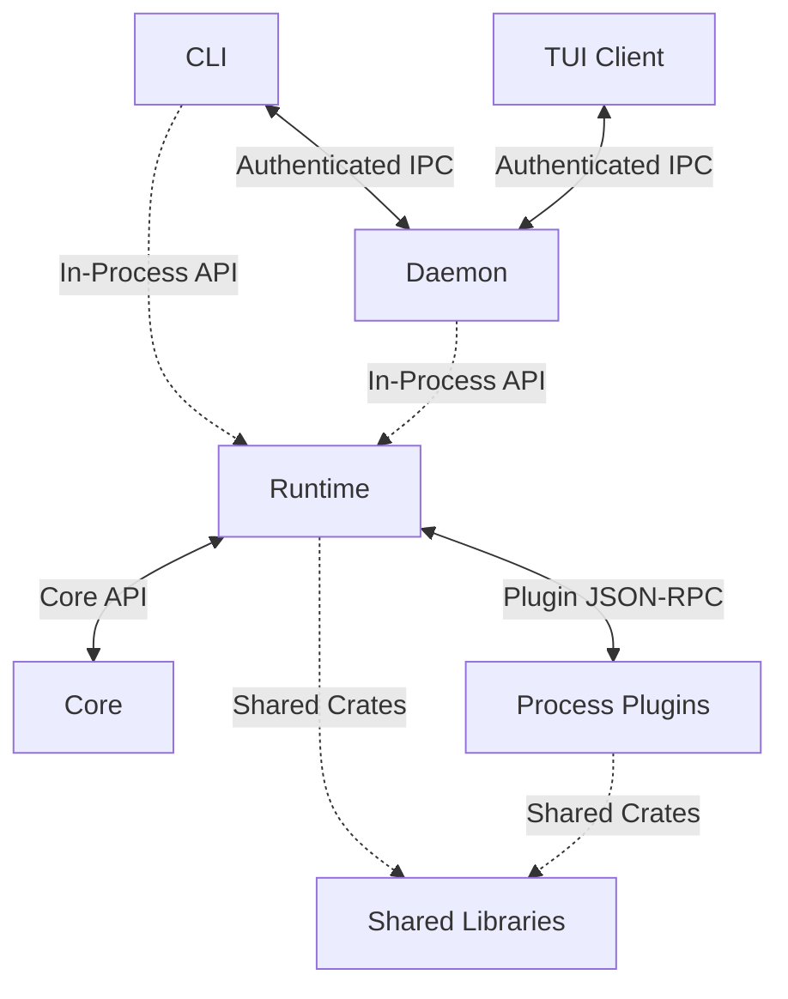

# Architecture

This guide explains Krabb’s process boundaries, runtime, and plugin protocol.

## Table Of Contents

- [Architecture Style](#architecture-style)
- [Turn Flow](#turn-flow)
- [Persistence](#persistence)
- [Protocol](#protocol)
- [Extension Rules](#extension-rules)
- [Security](#security)
- [Test Organization](#test-organization)

Plugin onboarding is host-owned. `krabb plugin setup <id>` and the
`krabb <id> setup` shortcuts read installed secret and setting declarations without
launching the plugin. Optional `[[settings]]` manifest entries carry environment
variable names and public defaults, and are pinned in the plugin lock alongside
secrets. Older manifests and locks default to no settings. The host saves secrets
and configured settings atomically in the same encrypted store and requests
authenticated `plugin.setup` IPC with only the ID and credential path. The daemon checks its
credential source before invoking the existing loader. Additional channels and
providers can activate without replacing the defaults.
An older daemon rejects the new method, leaving activation pending. Provider
account flows such as Codex login remain plugin commands; the plugin protocol
and capability-free core are unchanged.

Idle channel recovery releases the lifecycle guard during retry backoff and
reacquires it for each restart attempt. The attempt verifies the plugin is still
the current registry instance before restarting it. Repeated startup failures
therefore leave opportunities for uninstall, detach, and replacement; active
conversation turns still settle before destructive lifecycle operations.

The runtime encrypts persisted secrets with AES-256-GCM using a CSPRNG-generated
256-bit key and a fresh 96-bit nonce per write. Versioned envelopes authenticate
their format, key backend, and key identifier. The OS keyring holds the key when
available; the fallback key file has restricted permissions and an independent
path. Existing envelopes pin their key backend. Environment values override
storage; decryption errors prevent plugin launch rather than becoming missing
process environment. Nonempty environment values override stored settings;
manifest defaults fill missing settings. The core JSON-RPC protocol is unchanged.

Krabb uses a layered, hexagonal host/plugin architecture with a
microkernel-style core, isolated JSON-RPC plugins, and a client–daemon runtime.
The Core defines provider-neutral contracts, the Runtime provides host adapters
and lifecycle management, and plugins provide optional capabilities out of
process. This also applies dependency inversion: the Runtime depends on Core,
while Core remains independent of the Runtime and external providers.

Krabb is organized into six layers:

1. `krabb` is the user-facing CLI. It handles local commands and uses
   authenticated local JSON-RPC IPC when a command needs the daemon. The TUI
   requires this same daemon runtime for turns and session state.
2. `krabb-daemon` is the long-running service entrypoint. It starts the
   runtime and keeps the agent, state, bridges, and plugin processes alive.
3. `krabb-runtime` is the host layer shared by the CLI, daemon, and TUI's
   daemon-mediated turns. It
   owns configuration, persistence, lifecycle, installation and updates,
   session orchestration, channel bridges, and local IPC.
4. `krabb-core` is the provider-neutral agent foundation. It owns normalized
   messages, the turn loop, policy, routing, protocol types, and plugin
   process contracts. It does not depend on the runtime.
5. `krabb-plugins/` contains optional capabilities. Plugins are separate
   processes that communicate with the runtime through bounded JSON-RPC 2.0
   messages. Intelligence providers live under `intelligence/`, channels under
   `channels/`, and clients such as TUI under `clients/`. These folders do not
   change plugin IDs, capabilities, configuration, or protocol contracts. Local
   discovery still accepts the former `messaging/` and top-level TUI layouts;
   saved local sources using those paths resolve to the new locations when the
   old directories are absent.
6. `krabb-libs/` contains shared libraries for dates, logging, files, and
   process management. Consumers link only the libraries they need; these are
   not plugin processes or agent capabilities.

The CLI and TUI use authenticated IPC when they need daemon state or turns.

Global and channel provider/model changes use authenticated `config.selection.reload`
IPC after saving validated configuration. The daemon snapshots only the selection
policy; channel workers resolve it at each new event without restarting the worker
or interrupting a turn. Channel-created sessions follow configuration unless their
model is explicitly pinned. Legacy sessions without pin metadata inherit channel
configuration; local sessions and scheduled selections keep their existing behavior.

Model generation receives the remaining overall turn budget instead of a separate
120-second plugin-call limit. Channel and daemon-owned TUI turns remain bounded to
300 seconds and retain cancellation and cleanup behavior. Providers can enforce
shorter HTTP deadlines; Ollama permits 300 seconds for slow local generation.
Runtime and shared-library calls stay in-process; Runtime-to-plugin JSON-RPC
and client-to-daemon IPC cross process boundaries. The `krabb-libs/` crates
are compiled into their consumers, so plugins depend only on the libraries
they use. Plugins do not connect to Core at runtime. They implement its
Status queries the authenticated `plugin.active` inventory to report the daemon's
loaded intelligence and channels. It does not recheck their credentials in the
CLI's environment. Without a daemon, status falls back to local configuration
readiness. The JSON capability fields are `intelligence` and `channels`.

The TUI is a terminal client, not a second agent runtime. It submits turns over
authenticated local IPC; the daemon selects the model plugin, applies tool and
approval policy, executes tools, and persists every interaction. Terminal
rendering, typewriter reveal, and scroll state remain inside the TUI plugin.
TUI tool use is explicitly opt-in with `[clients.tui] tools = true` and remains
subject to the global approval mode.

Session data is stored under `KRABB_HOME/data/sessions/`: `index.json` is the
global catalog, `records/` contains opaque-keyed session records,
`state/clients/` contains runtime client state, and `state/deliveries/` contains
the delivery index and records. Existing root `sessions.json` and offline TUI
session data are imported on first daemon startup, with the daemon's copy taking
precedence on ID collisions; source files are retained.

The core is useful without plugins: `version`, `init`, `doctor`, `status`, and plugin
management still work. A model plugin handles `generate` with a normalized
`ModelRequest` and returns a `ModelReply`. The host is responsible for policy,
session ownership, approvals, timeouts, and durable state; model events cannot
grant their own approval. Plugins never call one another directly. Plugins may
register bounded CLI commands through JSON-RPC. Store,
memory, scheduler, MCP, speech, browser, isolated desktop, and client plugins
are explicit extension seams; only model, channel, and tool routing is enabled
in the initial daemon flow.

Remote schedule controls carry a host-supplied conversation identity through the
scheduler's `control` RPC, with typed source/conversation access and worktree
exclusions. The scheduler filters lists before pagination and authorizes mutations
against the captured origin while holding the mutation lock. Local CLI/TUI administration uses the
existing methods over authenticated IPC. Unsupported scoped controls fail closed
without retrying an unscoped request.

The runtime keeps a live registry of verified plugin processes. `plugin install`
and `plugin link` request authenticated IPC activation after committing the
plugin; `plugin uninstall` reserves the daemon lifecycle, waits for active channel,
TUI, and scheduled work to settle, then guards state, unloads the plugin, and removes
its files while holding the reservation. New dependent work waits until removal or
restoration finishes; cancellation, approval replies, and reservation-checked approval
history writes remain available. Offline
purge, guard checks, and removal hold the daemon lock throughout. The bridge wakes
when a channel or model is added, so a daemon need not restart to
discover it. Selected model plugins load when installed; their own request
handling reports missing authentication. Channels still load only when their
credentials are ready. `plugin update` unloads active plugin processes before replacing
their files, then reloads the same active set; inactive plugins stay inactive
and the daemon process remains running.

`plugin detach` uses authenticated `plugin.detach` with the same exclusive lifecycle
reservation, retaining installation and durable state. `plugin attach` loads an inactive
plugin and preserves an already active instance. The channel supervisor stops workers
whose plugins leave the registry; scheduled tasks respect explicit provider detachment.
`delivery.drop` also reserves the lifecycle before
mutating the queue, so a concurrent send settles first. Bulk drops optionally match an
exact channel ID and persist the batch in one store change with rollback on save failure.
Dropped history is terminal and is excluded from uninstall's pending-delivery guard.

On Windows, the daemon's service entrypoint connects to SCM through the shared
process library. The runtime reports readiness after plugin startup and IPC
publication, maintains progress while starting or stopping, and routes SCM stop
and shutdown controls through the same stop signal and cleanup as foreground IPC.
Service environment snapshots pin the installing user's Codex profile; Windows
includes that path when migrating private state access to `NT SERVICE\Krabb`.
Windows services use this dedicated virtual account with only the required directory
traversal privilege. Configured external workspace and media directories, plus memory
and SQLite parent directories, receive additive, inheritable modify grants that preserve
existing user permissions. Missing persistence directories are created, and existing
records, locks, and database sidecars receive the same access. Existing external memory
files and their writer locks also receive private ACLs granting the service full access,
so memory privacy checks can update their DACLs; parent permissions remain additive.
Configured Playwright packages (including sibling dependencies), Chromium directories,
and explicit Node.js executable paths receive additive read/execute grants.
Forced reinstalls stop the previous service before migration;
rollback retains the unprivileged identity. Forced configuration changes use the same
shutdown-aware restart operation as `service restart`.
ACP host tool approvals normalize the workspace before displaying complete arguments.
Requests exceeding the approval display limits are rejected before confirmation; only
reviewed arguments and the host approval flag reach the tools plugin.
ACP response reads use the shared bounded JSONL decoder, rejecting oversized frames
without waiting for a newline or EOF. Memory reloads propagate filesystem errors and
preserve active state; only invalid contents trigger corruption recovery. Browser
WebSocket routes apply the HTTP host and public-address checks to `ws` and `wss` URLs.
The MCP plugin initializes each stdio child before sending an operation, matches
responses by ID, and exposes HTTP session IDs for explicit reuse by the caller.
Its HTTP reader handles bounded JSON/SSE responses and empty acknowledgements.
Discord's bounded response collector preserves raw attachment bytes and decodes
UTF-8 only for textual REST responses.

OpenAI and OpenRouter finish a streaming generation when their terminal marker arrives,
including when the response transport remains open. Fatal plugin input errors retire
concurrent request handlers before waiting for the output channel to close.

## Turn Flow
for channel destinations. The channel handshake advertises accepted text formats;
the host forwards Markdown to capable adapters and converts it to readable plain
text for legacy channels. Platform rendering and chunking belong to each adapter,
using shared bounded parsing primitives from `krabb-text`. Persisted deliveries keep
the original source and negotiate again at delivery, so a plugin change does not
lose formatting. Streaming previews carry `draft: true` and render only the first
chunk; final delivery edits it and sends overflow once. Provider-independent research
guidance requires checking the exact supplied URL and reporting actual tool results.

The host reads `KRABB_HOME/data/system/KRAB.md` and `KLAW.md` as bounded system
context at the start of each turn. It appends the session's bounded transcript
after that context; the instruction text is not stored in the transcript, so
file edits take effect on the next turn. The host does not inject `AGENTS.md`
into general Krabb requests.

1. A channel plugin polls its provider and normalizes an external update into
   an event with stable IDs, sender data, room scope, text, and attachments.
2. The daemon checks channel policy, advances the channel offset, and records
   the event in its deduplication set before admitting work.
3. A new session gets a bounded transcript and a conversation-specific directory.
   An explicitly enabled worktree provides a Git checkout for groups and DMs;
   `krabb worktree setup` validates or initializes the repository after confirmation.
   Additional messages join the bounded session queue.
   If isolation fails, the host durably queues an actionable error reply before
   acknowledging the event, without calling the model or sharing the workspace.
4. The host creates a durable lease and sends a model request through the core
   turn loop. The loop enforces step and call limits and asks the host before
   every tool invocation. Bounded model deltas are sent through a bounded
   stream queue and coalesced into channel edits at most twice per second;
   tool transitions appear as progress updates. Each model step drains buffered deltas and
   emits any missing suffix from its completed text before running tools or returning, so
   earlier tool preambles cannot suppress the final answer.
   Before streaming begins, optional bounded typing hints provide channel
   feedback. Explicit model rejections finish the failed turn without replay;
   transport recovery remains separate.
5. Tool results and the model reply are persisted with the transcript before
   the channel acknowledgement is committed. Delivery uses a durable outbox
   with stable IDs and explicit `pending`, `sending`, `streaming`, and
   `uncertain` states. The completed reply edits the streamed message; a
   multi-part response edits its first chunk and sends the remaining chunks.
   A transport failure is never retried automatically because the provider
   may have accepted the message.

Tool definitions are collected from every active `tool` plugin through
`tools/list` and routed by their unique names. Tool results can contain
validated text and inline images. The runtime keeps those images in the active
turn so a vision-capable provider receives them as image inputs, then stores
only text for temporary tool screenshots in the session transcript.

Incoming images are pinned under the session lock after admission, within a disk-counted
64 MiB/1,024-file budget. Full or unavailable storage produces an omission notice.
Reclamation runs only after a successful session save and preserves every durable reference,
including queued, inflight, compacted, forked, and deferred content. Crash orphans are
reclaimed on the next successful save. Existing pins above the budget remain readable
but prevent new retention until reclaimed.

Cancellation is terminal for the active turn. A restart can requeue only a
lease marked replay-safe; a lease that reached a mutating tool is recorded as
interrupted instead of being replayed. Scheduled model replies requesting a retry also
pause when that lease records a possible mutation; a confirmed successful completion
still completes normally. Scheduled final responses are persisted before clearing the
lease, so a failed response save retains mutation evidence and pauses automatic retries.

## Persistence

State files are written through the shared `krabb-file` crate. The writer fsyncs content and a
transaction journal before replacement, atomically publishes each journal phase, and repairs
an interrupted transaction at the next read. Files are private on Unix and
owner-only on Windows. Windows security checks use canonical extended paths so long
data paths retain the same access controls. Discord stores its gateway sequence and session cursor
through the same path, allowing a resumed gateway session after a plugin
restart.

Configuration and plugin-lock readers recover metadata transactions under the same
exclusive lock used by writers. Metadata access waits up to five seconds for contention;
daemon ownership still fails immediately. Command discovery propagates metadata errors
instead of treating the registry as empty. Initialization recovers configuration before
creating defaults. Plugin update recovery validates the installed directory and backup against
the recovered committed lock, restoring the matching backup when needed. If neither
matches, recovery retains the backup and reports an error.

Memory processes hold an exclusive filesystem lock while reloading the index and
servicing reads or writes. CLI changes are visible to an already running daemon.
Both legacy session files and the session catalog apply restart recovery: safe
inflight messages are requeued, interrupted mutations are never replayed, and
unfinished deliveries become uncertain. Catalog version 3 stages immutable session
and delivery records, then publishes their references, client cursors, and per-run delivery receipts through
one atomic `data/sessions/index.json` replacement. Restart sees either the old
inflight request or the completed transcript and delivery together. Version 1 and 2
catalogs remain readable and upgrade on the next save.

## Protocol

Every plugin must answer `hello` with its ID, version, protocol, and capability
list. `ping` checks health and `shutdown` requests a clean stop. Unknown calls
return JSON-RPC method-not-found. Frames are bounded to eight MiB and every
request has a numeric ID when a response is required. A model may emit bounded
JSON-RPC notifications with method `event` while a request is in flight; the
host validates and folds those normalized `Event` values into the turn before
accepting the correlated response. Notifications never replace the final
response and are discarded when malformed.

Long-lived listeners use a shutdown-driven host connection. AG-UI keeps four
HTTP connections at most; each model request retains its 120-second deadline
and 256-notification budget, without a lifetime limit on completed runs.
Dropping or timing out an outbound host call removes its local registrations and
sends a `cancel` notification with `params.id` identifying the call. The host reads
cancellations during generation, drops the matching active handler, and removes
matching queued work. Queue time counts toward the request deadline. Late replies
for retired outbound IDs are discarded; never-issued response IDs remain errors.
AG-UI drains queued notifications before reconciling the final text and tool calls,
so a bounded notification stream does not truncate the completed response.
When a provider requests a declared frontend tool through `host/tool`, the bridge
restarts that provider process and returns the normalized pending call. The frontend
executes the tool and supplies its result on the next run; the host does not execute
or acknowledge completion of frontend tools.

Coverage gates measure every Rust source file in the workspace. Tests use local
fixtures and mock transports so provider, channel, process, and terminal paths
remain deterministic without credentials or external services.

The protocol is stable within the 0.x series. Plugin manifests declare a
compatible range, while `plugins.lock` records the exact installed source and
permissions. Minor releases add capabilities without breaking compatible
plugins.

## Extension Rules

Add shared data types, protocol methods, and policy primitives to
`krabb-core` only when they are provider-neutral. Put lifecycle, persistence,
IPC, and update orchestration in `krabb-runtime`. Put network clients, credentials,
filesystem capabilities, and vendor-specific payloads in a plugin. Normalize
wire data at the plugin boundary and keep credentials out of normalized events.

Every new capability needs a manifest, a deterministic protocol test, a README
installation line, and an entry in the release matrix. Plugins must tolerate
unknown requests with a JSON-RPC error, bound every response, and shut down
their child processes when the host cancels or restarts them. On Unix, the host
starts each plugin in a private process session and signals its remaining session
members during cleanup, including separate shell process groups. Process-tree ownership
begins immediately after spawn, so cancellation during the hello handshake terminates
the starting process tree and leaves the direct child to Tokio's reaper, including during restart.
Linux host shells install the shared process-group restriction before executing workspace
code, preventing descendants from leaving their group or session. On other Unix hosts,
tool shell execution requires the tracked Docker/Podman sandbox; unsupported host execution
fails before spawning workspace code. Typed TUI shell commands run directly on Linux and
Windows and reject execution on other hosts before spawning workspace code.
Tool discovery acquires the plugin connection before starting its response timeout, so an
active tool call does not make a healthy plugin appear unresponsive.
Turn cancellation restarts only model and tool provider processes with interrupted requests.
Each request retains its process lock through termination, reaping, and container removal;
retired responses cannot be consumed by a subsequent turn that reuses its request ID.
TUI and channel turns wait for cleanup before acknowledging cancellation. Scheduled turns
also wait before recording cancellation or releasing their workspace lock. Container cleanup failures keep cancellation pending and are retried.
Cancelling an idle session does not restart plugins. Plugins without interrupted requests
retain their state, including browser and desktop sessions.

Daemon-owned TUI turns, typed commands, and manual compaction pin their session reservation
in memory through execution, persistence, and cleanup. TUI answers and typed commands acknowledge
cancellation and retire their token after process cleanup, including when streaming fails.
Automatic compaction and generation share a 300-second turn deadline, within the TUI's
310-second request timeout. Failed or cancelled compaction waits for provider request cleanup
before subsequent generation; manual compaction uses the same cleanup path.
Recovery cannot reclaim a pinned reservation;
the guard releases it when the turn exits. This ownership is never persisted, so abandoned
reservations remain recoverable after a daemon restart.

## Security

The host treats plugins as executable trust boundaries. Filesystem tools must
stay below their configured root, TUI shell access is disabled by default, and every
mutating or risky action carries approval metadata. Logs must not contain
credentials or authorization headers.

## Test Organization

Unit tests use the owning module’s `#[cfg(test)] mod tests`, with larger suites split
into named child modules under its tests directory. Crate-level `tests/` contains
public-API and executable integration tests; `tests/support/mod.rs` supplies local fixtures.
The unpublished `krabb-libs/test` crate shares stream, cache, inbox and logging contracts through
dev-dependencies and explicit adapters. It adds no runtime or provider capability to the core.

The channel supervisor runs one cancellable bridge per loaded channel, up to 64.
It reconciles plugin additions and removals every 250 milliseconds. Each bridge
uses its channel's provider/model policy with the global selection as fallback;
a missing provider pauses only the affected bridge. Worker request ID ranges are
separate so cancellation cannot target another channel's requests. Shutdown signals
and joins every bridge before stopping plugins. Outbox selection and the transition
to sending occur under one store lock, preventing concurrent duplicate claims.
Inbound queues are selected by their persisted channel identity and chat, never
by a session-name prefix. Queued turns preserve the owning session ID, including
renamed sessions; queues with incomplete routing metadata are retained.
Approval waiters subscribe to the completion of their individual challenge.
Resolution, cancellation, or expiry closes that subscription, allowing an approved
turn to resume even while other channels have pending approvals or a channel poll
is blocked. Each wait still observes its turn deadline and cancellation signals.

## Schedule Results And Storage Ownership

A scheduled execution captures its origin and capabilities. Current origin access,
worktree restrictions, and tool policy are rechecked before each run. Scoped context,
memory, and data use the origin identity; schedule-management sharing cannot change it.

The host saves each full result and frozen recipient plan in
`data/schedules/runs/<job>/<run>/result.json`, then publishes outbox entries, local
TUI notices, and target receipts in one catalog transaction. Stable delivery IDs
prevent duplicates when a pending report is replayed. Each destination has its own
outcome; ambiguous channel delivery stays uncertain and is never automatically resent.
The scheduler's `receipt` RPC reconciles a crash after report acknowledgement.

Unchanged immutable records are verified and reused during catalog saves. Plain workspace file ownership is stored under `data/workspaces/files.json`.
Private conversation state stays under `data/workspaces/conversations/<conversation>`. See
[Storage](storage.md) for directory ownership, retention, and migration boundaries.
